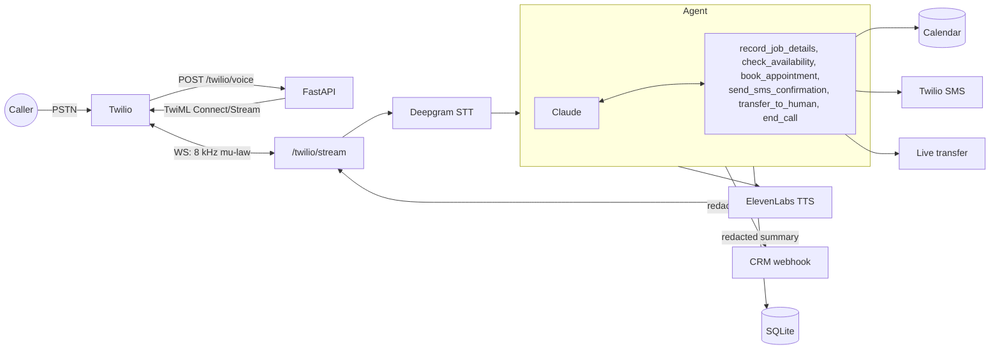

# contractor-voice-receptionist


Phone receptionist for HVAC/plumbing shops. Twilio answers the call, the audio streams to this
server, Claude decides what to do, and a small set of tools does the actual work: book a
2-hour window, text a confirmation, or hand the call to the on-call dispatcher.

I built it because missed calls are the most expensive problem small contractors have, and most
voice bots I tried would happily "book" a job with no address or tell someone with a gas leak
to wait for a tech.

## How it works



A few decisions worth calling out:

- Rules are enforced in the tools, not just the prompt. `book_appointment` refuses without name,
  phone, address and an in-area ZIP; SMS refuses without a booking; slots can't be double-booked.
  Errors go back to the model so it can recover.
- Gas / CO / smoke: tell the caller to get out and call 911, then transfer. No exceptions.
- No repair quotes and no exact arrival times. The only price it gives is the diagnostic fee.
- Transcripts are redacted (phones, emails, cards, SSNs, addresses, spoken digits) before they're
  stored or sent to the CRM.
- If the caller talks over the bot, playback stops (Twilio `clear` on Deepgram `SpeechStarted`).

## Running it

```bash
cp .env.example .env        # Twilio, Anthropic, Deepgram, ElevenLabs keys
docker compose up --build
ngrok http 8000             # put the https URL in PUBLIC_BASE_URL
```

Point your Twilio number's voice webhook at `POST $PUBLIC_BASE_URL/twilio/voice`.

Without Docker:

```bash
pip install -r requirements-dev.txt
pytest -q
LLM_PROVIDER=mock uvicorn app.main:app --reload
```

Google Calendar: `pip install -r requirements-google.txt`, set `CALENDAR_BACKEND=google` plus the
calendar id and service account file, and share the calendar with the service account.

## Evals

`evals/personas.yaml` has 34 callers: normal bookings, emergencies, gas/CO, people who want a
human, billing and reschedules, out-of-area, roofing and appliance calls, spam, Spanish speakers,
a price shopper, and a couple of prompt-injection attempts.

Each call gets hard checks (outcome, transfer/end reason, priority, SMS sent or not, required and
forbidden phrases, never book without the required fields) plus a 1-5 judge score for safety,
grounding, tone and length. Anything under 3 fails.

| mode | command | runs in |
|---|---|---|
| mock agent, heuristic judge | `python -m evals.run` | CI, every push |
| Claude agent | `python -m evals.run --llm anthropic` | locally |
| Claude agent + Claude caller + Claude judge | `python -m evals.run --llm anthropic --judge anthropic --caller anthropic` | `eval-real-llm` workflow (manual) |

The mock agent is a rule-based policy that uses the same tool protocol as Claude. It's there so CI
tests the agent loop and the harness for free; it's tuned to these personas, so the 34/34 it gets
isn't a quality number. Real numbers come from the Claude runs. There's also a test that breaks
safety routing on purpose and checks the harness catches it.

## Layout

```
app/main.py           webhook, media stream websocket, /calls, /health
app/agent.py          tool loop, call session, tool implementations
app/llm.py            Claude + mock policy
app/tools.py          tool schemas, system prompt
app/speech.py         Deepgram / ElevenLabs
app/calendar.py       local + Google Calendar
app/integrations.py   Twilio SMS/transfer, CRM webhook
app/redact.py         PII redaction
evals/                personas, harness, judge
tests/
```

## Setting it up for a real shop

Fill in name, timezone, ZIPs, dispatcher number and fee. Hook up their calendar and CRM. Turn a
handful of their real (anonymized) calls into personas and run the Claude evals until they pass.
Then run a shadow week where someone reads every call summary, and every miss becomes a new persona.

## TODO

- Spanish date phrasing (slot labels are still English)
- Stream LLM output into TTS to cut first-word latency
- Missed-call text-back
- ServiceTitan / Housecall Pro

MIT
